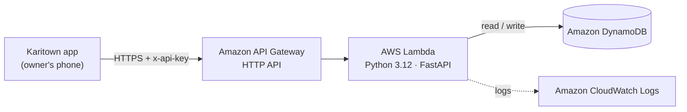

# Karitown

**Kariton Rolling Into Town.** An app for junkshop owners in the Philippines. They buy scrap by weight, fill a truck load, sell it to a buyer, and see how much money went out, came in and was earned per load.

The backend runs on AWS with **API Gateway, Lambda and DynamoDB**, and the infrastructure is written in Python with the **AWS CDK**.



## What's in this repository

| Folder | What it is | Status |
|---|---|---|
| [`backend/`](backend/) | The API and business rules (Python, FastAPI) plus its AWS setup (CDK) | Working, 26 tests |
| [`frontend/`](frontend/) | The phone app: offline-first PWA (React, TypeScript, Vite) | Working: all screens, offline-first |
| [`docs/`](docs/) | Business rules, architecture notes, screenshots | |
| [`.github/workflows/`](.github/workflows/) | Runs backend tests and the frontend build on every push | |

## Quick start

```bash
cd backend
python -m venv .venv
source .venv/bin/activate          # Windows: .venv\Scripts\activate
pip install -r requirements-dev.txt
pytest                             # 25 tests, no AWS account needed
```

To run the app in your browser with a local backend, see [frontend/README.md](frontend/README.md#run-it-on-your-computer).

Deploying to AWS: see [backend/README.md](backend/README.md#deploy-to-aws).

## Documentation

- [Architecture and AWS choices](docs/architecture.md)
- [Business rules](docs/business-rules.md): how weights, prices, loads and sales work
- [Brand guide](docs/design/brand.md): logo, colours, typography
- [Frontend guide](frontend/README.md): folder map and how to run the app
- [Backend guide](backend/README.md): folder map, endpoints, running locally, deploying

## Screenshots

_Add after deploying: the API's `/docs` page and the CloudFormation stack, saved in `docs/screenshots/`._
