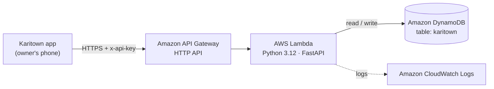

# Karitown backend

A serverless backend for **Karitown**, an app that helps junkshop owners in the Philippines buy scrap by weight, fill a truck load, sell it to a buyer, and track their money. It's built with **AWS Lambda, API Gateway and DynamoDB**, and the AWS setup is written in Python with the **AWS CDK**.

## Architecture



**How the code is organised:** each screen of the app has a file in `app/routes/` (its URLs) that uses a file in `app/rules/` (its calculations). Routes read and save data through `database.py`; rules never touch the database, so they're quick to test and easy to reuse.

| Tier | AWS service | Why I chose it |
|---|---|---|
| Presentation | The phone app | Saves records on the phone first, so owners can work with no signal |
| Application | API Gateway + Lambda | No server to manage; pay only per request (nearly free at this size) |
| Data | DynamoDB (on-demand) | No database server, no passwords, no VPC; scales automatically |
| Monitoring | CloudWatch Logs | Every request's errors are visible for 14 days |

**Offline-first:** the phone gives each new purchase or sale its own `id`. If the phone sends the same record twice (because of weak signal), DynamoDB's conditional write (`attribute_not_exists(id)`) makes sure it's only saved once.

## Folder structure

```
backend/
├── app/                    the application code
│   ├── main.py             puts the app together: API key check, error handling, all routes
│   ├── routes/             the URLs, one file per screen of the app
│   │   ├── materials.py    Materials & prices
│   │   ├── suppliers.py    Suppliers
│   │   ├── buyers.py       Buyers
│   │   ├── purchases.py    Buy (Pasok Kalakal): save, void, correct
│   │   ├── loads.py        Truck loads: start, capacity, close, pick up, reopen
│   │   ├── sales.py        Record sale, undo sale, margin
│   │   └── reports.py      Home totals and Ledger
│   ├── rules/              the business rules, one file per topic (no database or web code)
│   │   ├── prices.py       listed price, price checks, old-price flag
│   │   ├── buying.py       gross − tare − defect = payable, × price
│   │   ├── loads.py        how full the truck is
│   │   ├── selling.py      sale amount, splitting a mixed price, margin
│   │   └── money.py        periods (today/week/month) and cash totals
│   ├── models.py           the shape of each request (checked automatically)
│   ├── database.py         DynamoDB helpers: get, list, save, receipt numbers
│   ├── common.py           small shared helpers: now(), new_id(), find()
│   ├── errors.py           RuleError: a broken business rule, shown to the user
│   └── demo_data.py        sample shop data (materials, suppliers, buyers)
├── infra/
│   └── stack.py            the AWS setup (CDK): DynamoDB table, Lambda, API Gateway, logs
├── tests/
│   ├── test_rules.py       the business rules, using worked examples
│   ├── test_api.py         the full flow through the API, with a fake DynamoDB (moto)
│   └── test_infra.py       checks the AWS setup without deploying it
├── cdk_app.py              CDK entry point: creates the "Karitown" stack
├── cdk.json                tells the cdk command to run cdk_app.py
├── requirements.txt        libraries the app needs on AWS
├── requirements-dev.txt    extra libraries for testing and for CDK
└── README.md
```

## How it works (same flow as the prototype)

| Prototype screen | Endpoint |
|---|---|
| Home: cash out / cash in by period, open load | `GET /summary?period=today\|week\|month\|custom` |
| Materials & prices (add, edit, remove, old-price flag) | `GET/POST /materials`, `PUT/DELETE /materials/{id}`, `GET /categories` |
| Buy (Pasok Kalakal): weigh items, save | `POST /purchases` |
| Void or edit a saved purchase | `POST /purchases/{id}/void`, `POST /purchases/{id}/correct` |
| Load: list, details, capacity | `GET /loads`, `GET /loads/{id}`, `POST /loads`, `PUT /loads/{id}/capacity` |
| Load steps: Open → Closed → Picked up → Sold | `POST /loads/{id}/close`, `/pickup`, `/reopen`, `POST /sales` |
| Undo a sale | `POST /sales/{id}/void` |
| Margin for a sold load | `GET /loads/{id}/margin` |
| Ledger | `GET /ledger?period=week` |
| Buyers and suppliers | `GET/POST/PUT/DELETE /buyers`, `/suppliers` |

**Rules the backend enforces:**
- Weights are stored in grams and money in centavos, as whole numbers, so there are no rounding errors.
- One item's amount is: payable weight = gross − tare − defect, then payable × price per kilo.
- Nothing is deleted. Mistakes are voided with a reason, and editing a purchase voids it and saves a corrected copy.
- Only one load can be open at a time. Saving a purchase with no open load starts a new one.
- A purchase can't be changed once its load is closed.
- Only materials on the price list can be bought.

## Run it on your computer

You need Python 3.12. Run these commands inside the `backend/` folder.

```bash
python -m venv .venv
source .venv/bin/activate          # Windows: .venv\Scripts\activate
pip install -r requirements-dev.txt
pytest                             # 25 tests, no AWS account needed
```

To click through the API locally, start DynamoDB Local in Docker, then the app:

```bash
docker run -d -p 8001:8000 amazon/dynamodb-local
export DYNAMODB_ENDPOINT=http://localhost:8001 AWS_DEFAULT_REGION=ap-southeast-1 \
       AWS_ACCESS_KEY_ID=local AWS_SECRET_ACCESS_KEY=local
python -m app.database             # create the table
python -m app.demo_data            # add sample materials, suppliers, buyers
uvicorn app.main:app --reload      # open http://127.0.0.1:8000/docs
```

## Deploy to AWS

You need an AWS account, the [AWS CLI](https://docs.aws.amazon.com/cli/latest/userguide/getting-started-install.html) (run `aws configure`), [Node.js](https://nodejs.org/) and [Docker](https://www.docker.com/products/docker-desktop/) running. CDK uses Docker to install the libraries for Lambda's Linux.

```bash
npm install -g aws-cdk                                  # the cdk command (once)
pip install -r requirements-dev.txt                     # in your activated .venv
cdk bootstrap                                           # once per AWS account and region
cdk deploy --parameters ApiKey=pick-a-long-random-text  # region: ap-southeast-1 (Singapore)
```

The output shows `ApiUrl`. Open `<ApiUrl>/docs` to try every endpoint in the browser: each one has an `x-api-key` box where you type your key. From the terminal:

```bash
curl -H "x-api-key: YOUR_KEY" <ApiUrl>/health
```

To add the sample data in AWS, run `TABLE_NAME=<TableName from outputs> python -m app.demo_data` with your AWS credentials.

**Cost:** about US$0–1 a month at demo traffic (Lambda, API Gateway and DynamoDB on-demand all have free tiers).
**Remove everything:** `cdk destroy`.

## What I'd add next

- Sign-in per shop (Amazon Cognito) instead of one shared API key
- The phone app (PWA) with offline storage, hosted on S3 + CloudFront
- Automatic deploys from GitHub Actions
