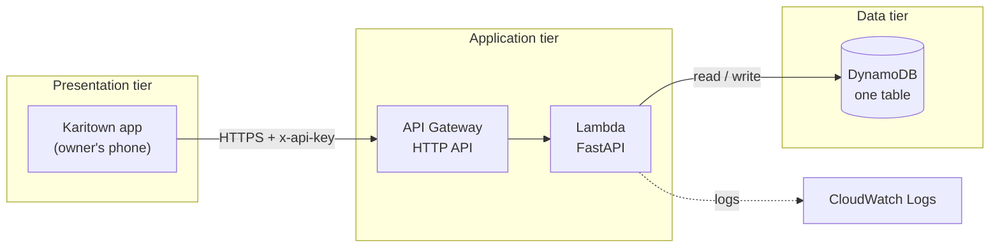

# Architecture

Karitown uses a 3-tier serverless design on AWS, in the Singapore region (`ap-southeast-1`), the closest to the Philippines.

## Why these services

| Need | Choice | Reason |
|---|---|---|
| Run the API | **AWS Lambda** | No server to manage or patch; pay per request; nearly free at demo traffic |
| Public URL | **API Gateway HTTP API** | HTTPS out of the box, cheaper and simpler than the REST API type |
| Store data | **DynamoDB, on-demand** | No database server, VPC or password; scales automatically; free tier covers a demo |
| See errors | **CloudWatch Logs** | Every function error is logged; kept for 14 days |
| Define all of the above | **AWS CDK (Python)** | Infrastructure as code in the same language as the app; one command to deploy or delete |

## How one purchase flows

1. The phone sends `POST /purchases` with its own record `id` and the API key.
2. API Gateway passes the request to the Lambda function.
3. The function checks each item with the business rules (`backend/app/rules/`) and finds or starts the open truck load.
4. It saves the purchase to DynamoDB **only if that id is new** (a conditional write). A retry after weak signal is not counted twice.
5. It answers with the total and how full the truck is.

## Data model

One DynamoDB table with two keys:

| Key | Example | Meaning |
|---|---|---|
| `kind` (partition key) | `purchase` | What type of record it is |
| `id` (sort key) | `3f2c…` | The record's own id |

"All purchases" is a single query: `kind = "purchase"`. Receipt numbers (PUR-0001, L-0001, SAL-0001) come from counter items with `kind = "counter"`, updated atomically.

## Security

- The API needs an `x-api-key` header. The key is set at deploy time and never stored in the code.
- The Lambda function may read and write only its own table (least-privilege IAM, granted by CDK).
- Point-in-time recovery is on for the table.

## Next steps

- Sign-in per shop with Amazon Cognito, replacing the shared API key
- The PWA on S3 + CloudFront
- Deploys from GitHub Actions using OIDC (no stored AWS keys)
